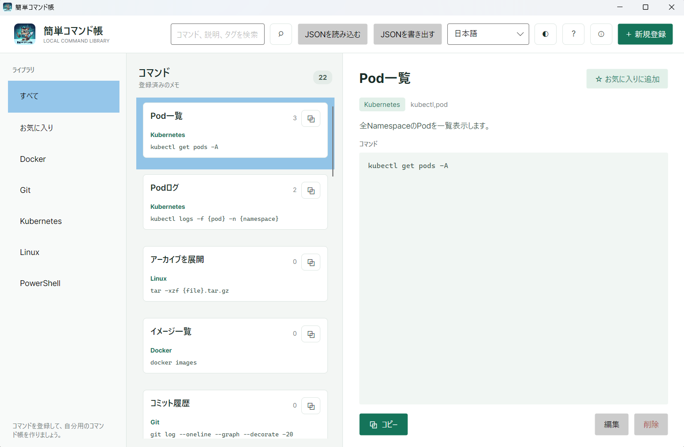
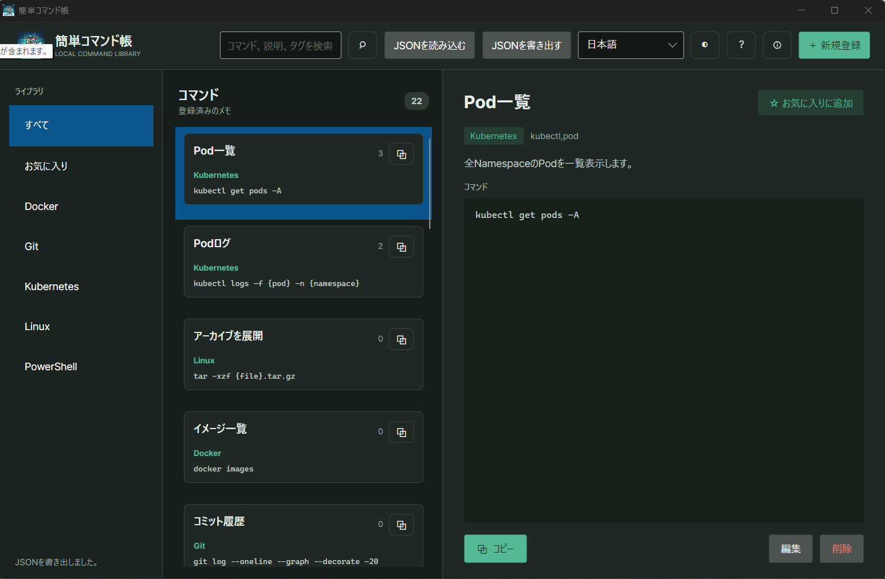
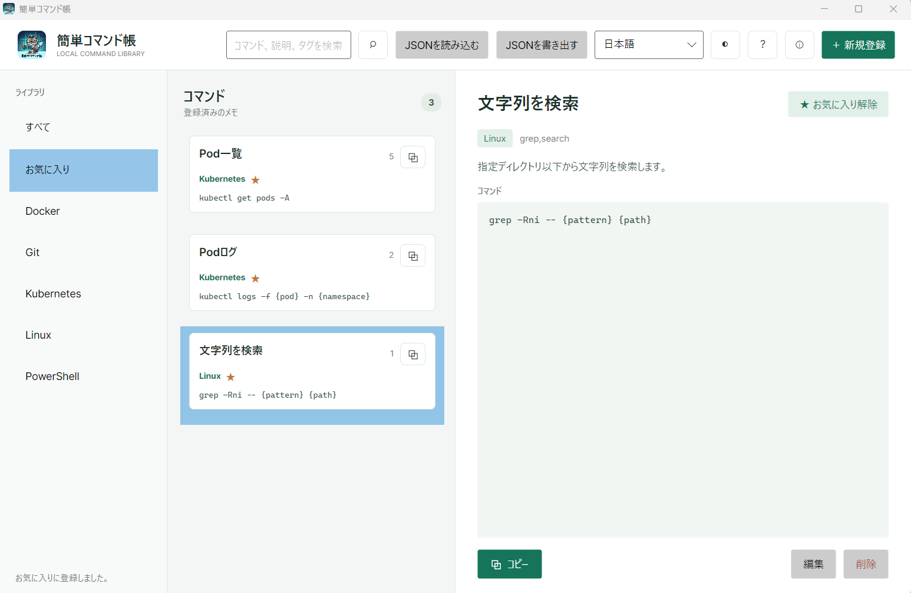
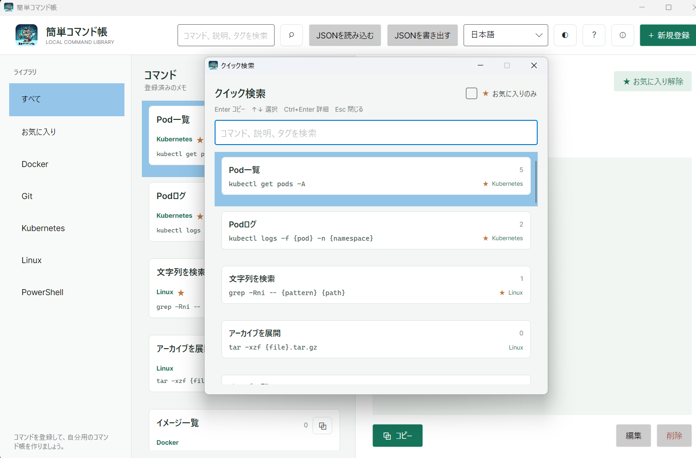
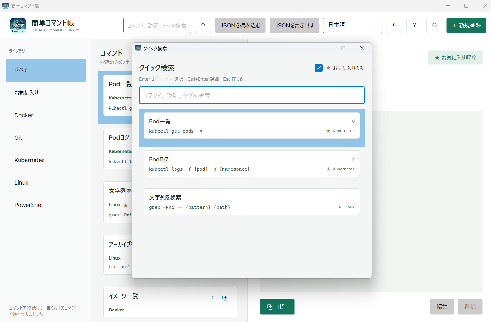
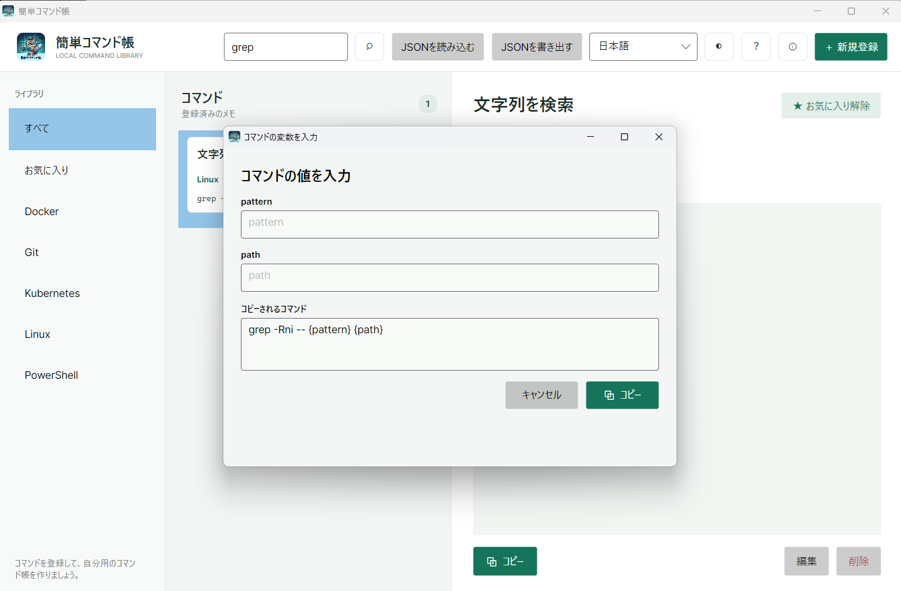
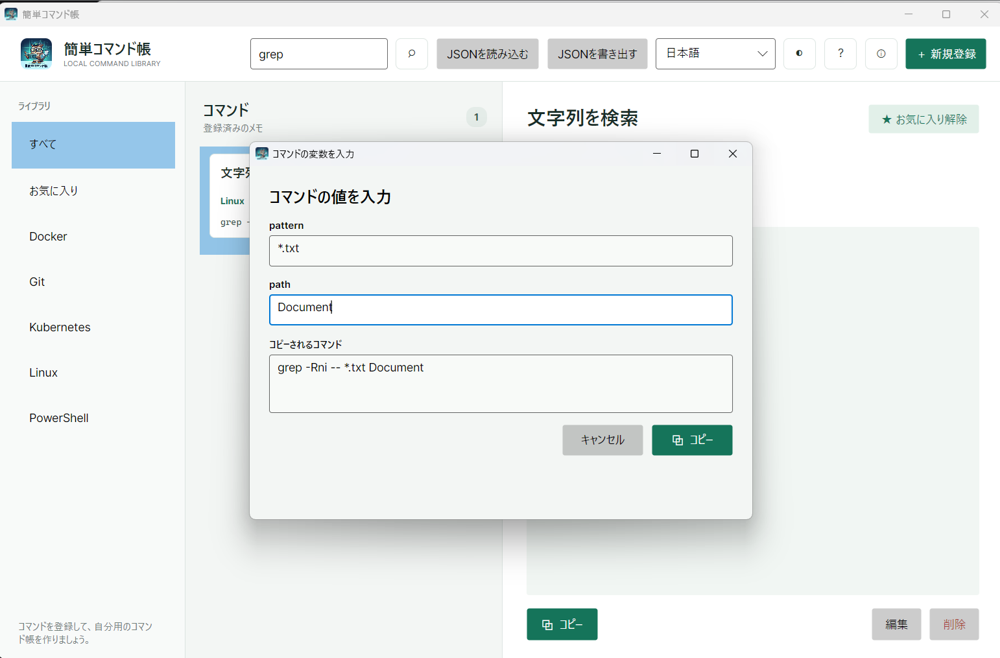
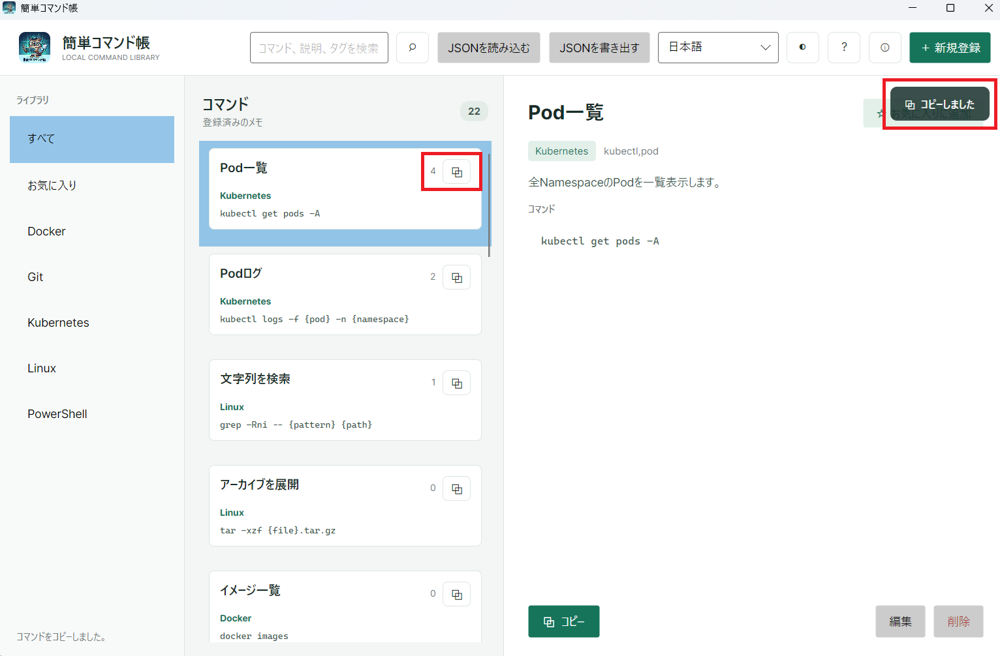
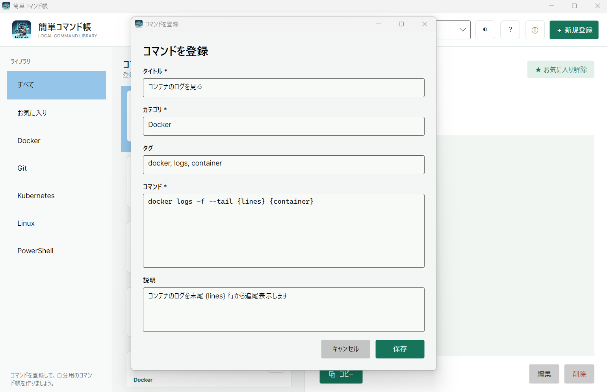
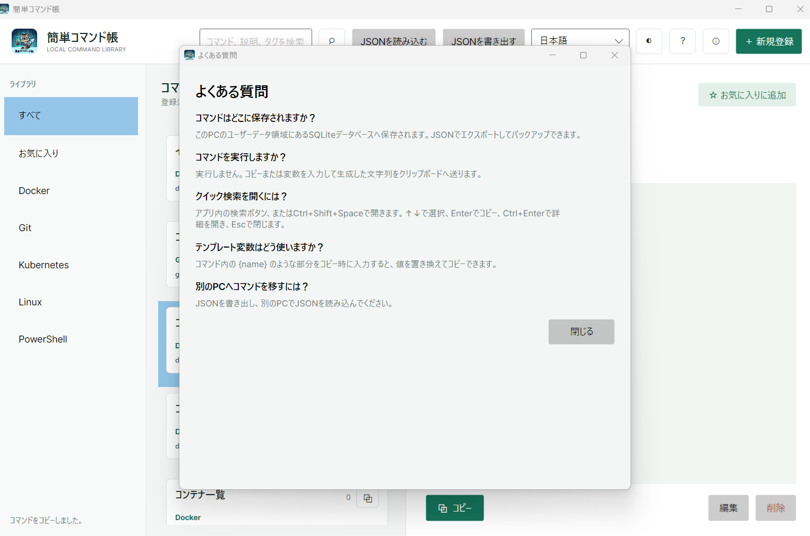

# EasyCommandMemo（簡単コマンド帳）

[](https://github.com/kumatarosasaki3891-art/EasyCommandMemo/releases)
[](https://apps.microsoft.com/detail/9MTDGWRVRKNZ?hl=ja&gl=JP&ocid=pdpshare)
[](LICENSE)

[English](README_EN.md) | 日本語

コマンドを保存・検索・コピーするための、シンプルで高速な個人用コマンドライブラリ（Avalonia / F# / .NET 10）です。  
登録したコマンドは PC 内の SQLite データベースにローカル保存され、必要なときにすぐ検索・コピーできます（通信やコマンドの自動実行は行いません）。

> A simple, fast personal command library for saving, searching, and copying commands locally—with Quick Search, Favorites filtering, `{variable}` template prompts, JSON backup, and 11-language UI.

---

## 📥 ダウンロード / Download

- **🐧 Linux版 (Flatpakバンドル)**: [GitHub Releases](https://github.com/kumatarosasaki3891-art/EasyCommandMemo/releases)（下記「Flatpak パッケージのビルド」および [FLATHUB_GUIDE.md](FLATHUB_GUIDE.md) からビルドも可能）
- **🪟 Windows 10 / 11版**: [Microsoft Store から無料で入手](https://apps.microsoft.com/detail/9MTDGWRVRKNZ?hl=ja&gl=JP&ocid=pdpshare) / [紹介サイト](https://sites.google.com/view/kuma-applications/%E7%B0%A1%E5%8D%98%E3%82%B3%E3%83%9E%E3%83%B3%E3%83%89%E5%B8%B3)（下記手順からソースビルド・MSIX パッケージ作成も可能です）

---

## 📸 画面イメージ / Screenshots



**メイン画面（ライトモード）** — カテゴリ・タグ・検索ボックスでコマンドを整理し、詳細とコマンド本文を一覧できます

| ダークモード | お気に入り管理 |
| :---: | :---: |
| <br>ワンクリックでライト／ダークテーマを切り替え可能 | <br>よく使うコマンドに ★ を付けて左メニューからすぐ呼び出し |

| クイック検索画面 | クイック検索（お気に入りのみ絞り込み） |
| :---: | :---: |
| <br>キーワード入力とコピー回数順で候補を即座に絞り込み | <br>「★ お気に入りのみ」チェックで登録済みのお気に入りだけに絞り込み |

| テンプレート変数入力 | 変数置換のライブプレビュー |
| :---: | :---: |
| <br>`{pattern}` などのプレースホルダをコピー時に入力 | <br>入力内容が即座に反映され、完成コマンドを確認してコピー |

| ワンクリックコピー＆回数カウント | コマンド登録ダイアログ |
| :---: | :---: |
| <br>コピー回数をローカル集計し、トーストで通知 | <br>タイトル・カテゴリ・タグ・コマンド・説明を登録・編集 |

| よくある質問 (FAQ) |  |
| :---: | :---: |
| <br>保存先・ショートカット・変数機能のヘルプをアプリ内で確認 |  |

---

## 主な機能

- **ローカル SQLite 保存 & JSON バックアップ**
  - コマンド・カテゴリ・タグ・説明文・お気に入り・コピー回数をローカル SQLite に保存します（通信は一切行いません）。
  - JSON のインポート／エクスポートで、別 PC への移行やバックアップが簡単に行えます。
- **クイック検索ランチャー (`Ctrl+Shift+Space` / `--quick`)**
  - 作業中でもショートカットひとつで検索ウィンドウを呼び出し、タイトル・コマンド・タグなどの関連度とコピー回数順で候補を即座に絞り込めます。
  - ヘッダーの **「★ お気に入りのみ」** チェックボックスで、お気に入り登録済みコマンドだけへの絞り込みも可能です。
- **テンプレート変数展開 (`{name}`)**
  - `docker logs -f {container}` のように `{変数名}` を含めて保存すると、コピー時に値入力ダイアログが開き、プレビューしながら置換コピーできます。
- **テーマ切替 & 11 言語対応**
  - ライト／ダークモードの切り替え、日本語・英語・中国語（簡体/繁体）・韓国語・ベトナム語・ドイツ語・フランス語・スペイン語等 11 言語に対応しています。

---

## 使い方・ショートカットキー

### クイック検索の操作

| キー | 動作 |
|---|---|
| `Ctrl+Shift+Space` | クイック検索を開く（Windows / Linux X11） |
| `↑` / `↓` | 候補を選択 |
| `Enter` | 選択中のコマンドをコピー（変数があれば入力ダイアログを表示） |
| `Ctrl+Enter` | メイン画面で選択コマンドの詳細を開く |
| `Esc` | クイック検索を閉じる |

---

## 単一起動・コマンドラインオプション

簡単コマンド帳は **単一起動（シングルインスタンス）** に対応しています。既にアプリが起動中の場合、二重起動せず既存のプロセスへ指示を送ります。

| コマンドライン | 動作 |
|---|---|
| `EasyCommandMemo`（引数なし） | 未起動なら通常起動。既に起動中なら既存ウィンドウを前面表示します。 |
| `EasyCommandMemo --quick`（または `-q`） | 未起動なら起動してクイック検索を表示。既に起動中なら既存プロセスのクイック検索を前面に開きます。 |

---

## Linux（Wayland / Flatpak）でのクイック検索ショートカット設定手順

Linux の **Wayland セッション**や **Flatpak サンドボックス**では、OS・サンドボックス側のセキュリティ制約によりアプリケーション単体からのグローバルホットキー監視（`Ctrl+Shift+Space`）は動作しません。  
そのため、これらの環境ではアプリ側のグローバルホットキーを自動で抑止し、デスクトップ環境のカスタムショートカットから `--quick` オプション付きで呼び出す方式を採用しています。

> **補足**: ネイティブ版を Linux の **X11 セッション**で実行している場合は、アプリ内蔵のグローバルホットキーがそのまま利用できます。

### 設定手順（Ubuntu / GNOME）

1. **「設定」** → 左メニューの **「キーボード」** → 下部の **「ショートカットの表示とカスタマイズ」** を開きます。
2. **「独自のショートカット」**（カスタムショートカット）を選び、**「＋」**（または **「ショートカットを追加」**）をクリックします。
3. 以下のように入力します。
   - **名前**: `簡単コマンド帳 クイック検索`
   - **コマンド**:
     - **Flatpak 版の場合**: `flatpak run io.github.kumatarosasaki3891_art.EasyCommandMemo --quick`
     - **自己完結バイナリ版の場合**: `/path/to/EasyCommandMemo --quick`（空白を含むパスの場合は `"..."` で囲ってください）
   - **ショートカット**: **「ショートカットを設定」** をクリックし、`Ctrl+Shift+Space` を押します。
4. **「追加」** をクリックして保存します。

これで、作業中のどの画面からでも `Ctrl+Shift+Space` を押すだけで起動済みインスタンスのクイック検索が即座に開きます（未起動の場合は起動してクイック検索が開きます）。

---

## 起動・ビルド方法

### 1. ソースからの起動（.NET 10 SDK）

```bash
dotnet build EasyCommandMemo/EasyCommandMemo.fsproj -c Release
dotnet run --project EasyCommandMemo/EasyCommandMemo.fsproj
```

### 2. MSIX パッケージのビルド（Windows / Microsoft Store 配信用）

> **Note:** GitHub 公開用に [`EasyCommandMemo/Package.appxmanifest`](EasyCommandMemo/Package.appxmanifest)、[`build-msix.ps1`](build-msix.ps1)、[`build.ps1`](build.ps1)、[`EasyCommandMemo/Assets/Store/README.md`](EasyCommandMemo/Assets/Store/README.md) 内の Microsoft Store 識別情報・発行者情報は `XXXX` に置き換えています。ご自身の環境でパッケージングする場合は適宜書き換えてください。

Windows 10/11 SDK（`makeappx.exe`, `makepri.exe`, `signtool.exe`）がインストールされた環境でビルドできます：

```powershell
.\build-msix.ps1
# または
.\build.cmd
```

ローカルテスト用に自己署名証明書で署名する場合：

```powershell
.\build-msix.ps1 -SignForTesting
```

### 3. Flatpak パッケージのビルド（Linux 配信用）

`org.freedesktop.Platform//25.08` と `.NET 10 SDK` 拡張向けの設定ファイル一式を同梱しています。手順の詳細は [FLATHUB_GUIDE.md](FLATHUB_GUIDE.md) を参照してください。

```bash
flatpak-builder --user --install --force-clean build-dir io.github.kumatarosasaki3891_art.EasyCommandMemo.yaml
flatpak run io.github.kumatarosasaki3891_art.EasyCommandMemo
```

### 4. Linux（自己完結型バイナリのパブリッシュ）

```bash
dotnet publish EasyCommandMemo/EasyCommandMemo.fsproj -c Release -r linux-x64 --self-contained true -o ./publish/commandmemo-linux
```

---

## ディレクトリ構成

```text
EasyCommandMemo/
├── EasyCommandMemo/                             # 本体アプリ (Avalonia UI / F# / net10.0)
│   ├── Assets/                                  # アプリアイコン・Store 用アセット
│   ├── Data/                                    # SQLite リポジトリ (CommandRepository.fs)
│   ├── Models/                                  # データモデル (CommandEntry.fs)
│   ├── ViewModels/                              # MVVM ViewModel (MainViewModel.fs 等)
│   ├── Views/                                   # Avalonia ウィンドウ (MainWindow / QuickLauncherWindow / EditCommandWindow)
│   ├── GlobalHotKeyService.fs                   # X11 / Windows グローバルホットキー (Wayland / Flatpak では自動抑止)
│   ├── SingleInstanceService.fs                 # 単一起動ロック・IPC (--quick / Flatpak ソケット対応)
│   ├── Localization.fs                          # 11言語ローカライズ定義
│   ├── Package.appxmanifest                     # Windows MSIX マニフェスト (識別情報は XXXX でマスク済み)
│   └── EasyCommandMemo.fsproj                   # プロジェクトファイル
├── docs/screenshots/                            # スクリーンショット画像 (日英)
├── build-msix.ps1 / build.ps1 / build.cmd       # Windows MSIX ビルドスクリプト (Store 識別情報は XXXX でマスク済み)
├── FLATHUB_GUIDE.md                             # Flathub / Flatpak パッケージングガイド
├── io.github.kumatarosasaki3891_art.EasyCommandMemo.desktop
├── io.github.kumatarosasaki3891_art.EasyCommandMemo.metainfo.xml
├── io.github.kumatarosasaki3891_art.EasyCommandMemo.yaml
├── nuget-sources.json                           # Flatpak オフラインビルド用 NuGet 依存定義
├── EasyCommandMemo.slnx                         # ソリューションファイル
└── LICENSE                                      # MIT ライセンス
```

---

## 関連リンク

- **紹介サイト**: https://sites.google.com/view/kuma-applications/%E7%B0%A1%E5%8D%98%E3%82%B3%E3%83%9E%E3%83%B3%E3%83%89%E5%B8%B3
- **開発者 Instagram**: https://www.instagram.com/zefa_25_zefa/

---

## ライセンス

[MIT License](LICENSE)
