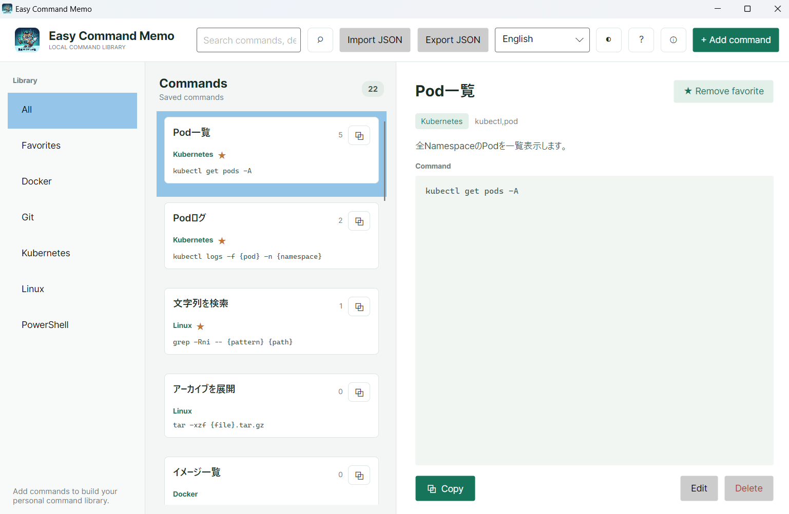
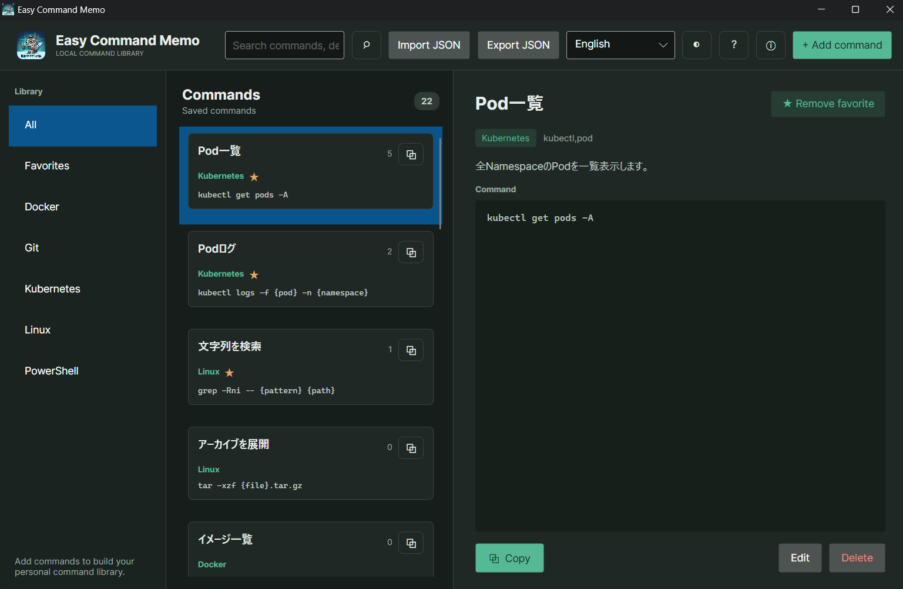
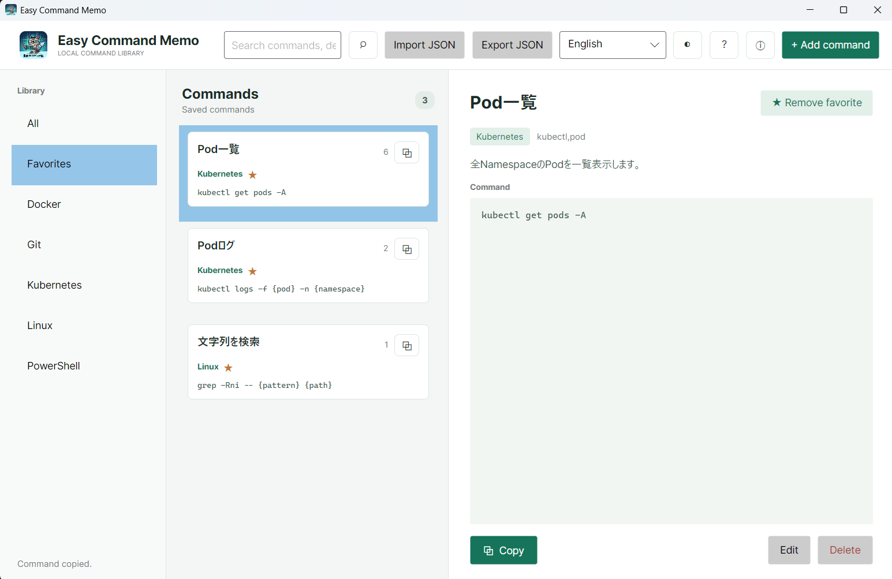
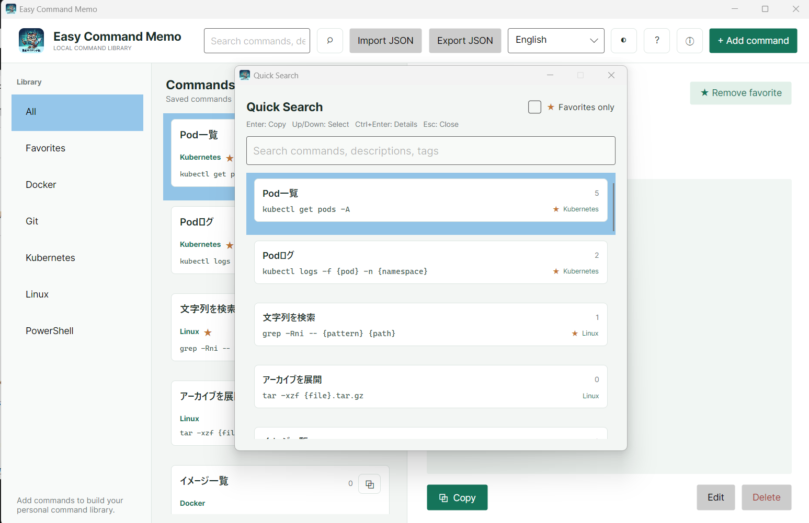
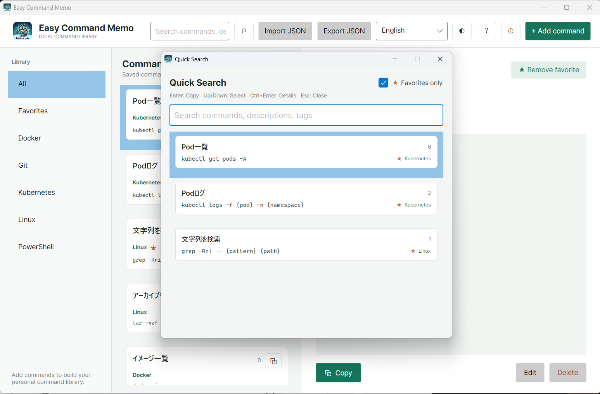
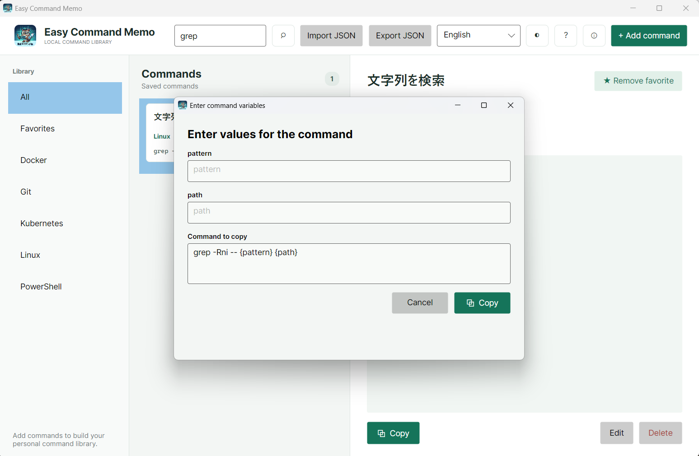
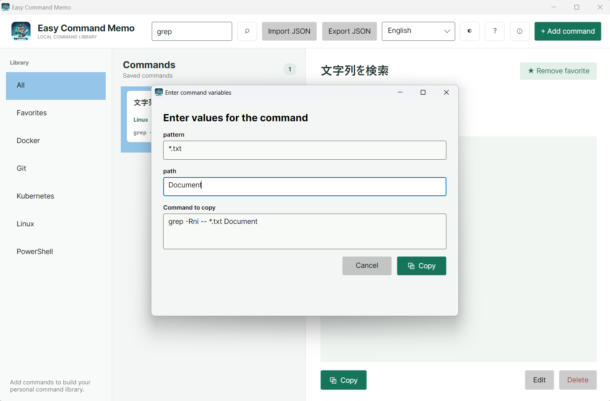
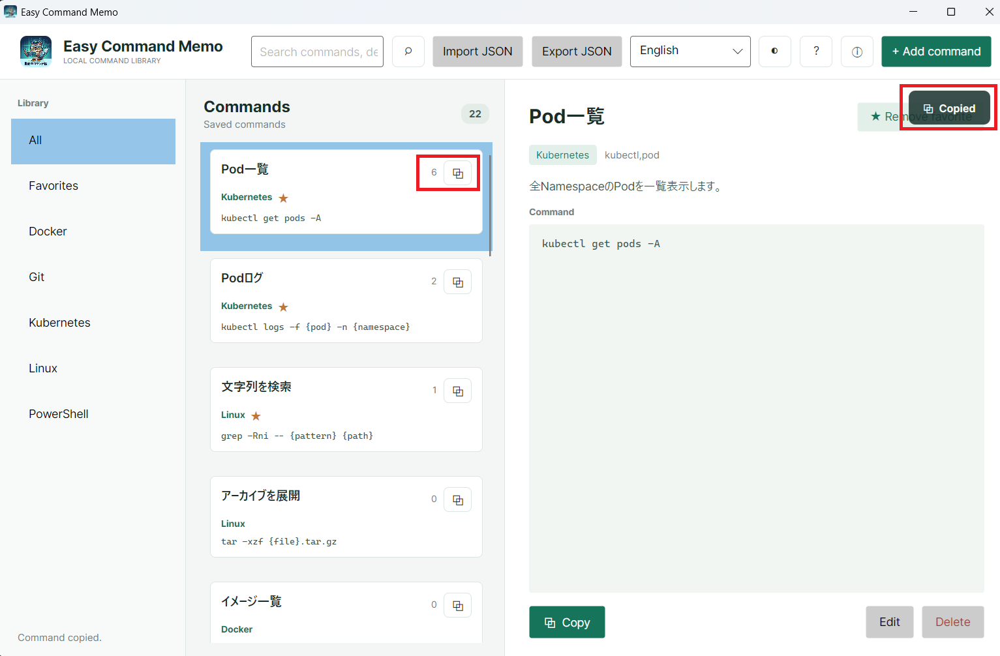
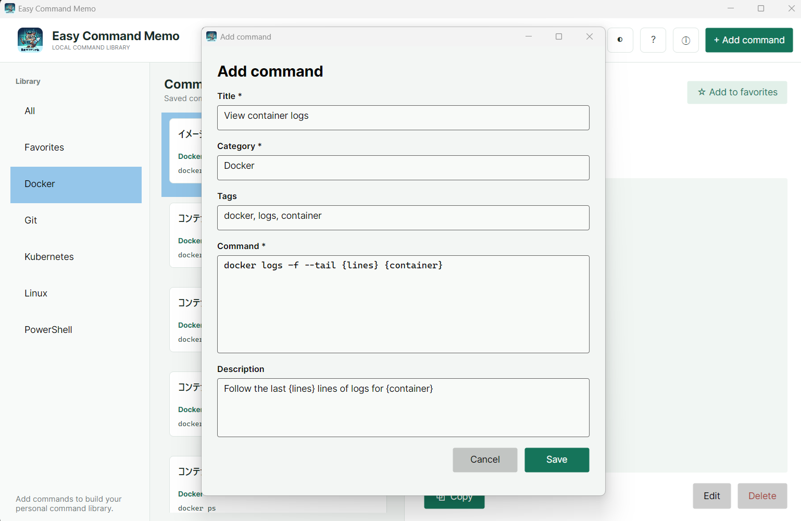
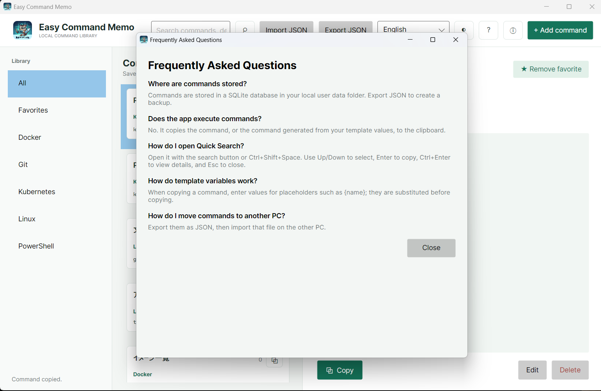

# EasyCommandMemo (簡単コマンド帳)

[](https://github.com/kumatarosasaki3891-art/EasyCommandMemo/releases)
[](https://apps.microsoft.com/detail/9MTDGWRVRKNZ?hl=en-us&gl=US&ocid=pdpshare)
[](LICENSE)

English | [日本語](README.md)

A simple, fast personal command library built with Avalonia (F# / .NET 10) for saving, searching, and copying commands locally.  
Your commands are stored locally in a SQLite database on your PC so you can find and copy them immediately (the app performs no network requests and never auto-executes commands).

> A lightweight cross-platform desktop command memo with Quick Search, Favorites filtering, `{variable}` template prompts, JSON backup, Light/Dark themes, and 11-language UI.

---

## 📥 Download

- **🐧 Linux (Flatpak bundle)**: [GitHub Releases](https://github.com/kumatarosasaki3891-art/EasyCommandMemo/releases) (or build locally using the Flatpak instructions below and [FLATHUB_GUIDE.md](FLATHUB_GUIDE.md))
- **🪟 Windows 10 / 11**: [Get it free from the Microsoft Store](https://apps.microsoft.com/detail/9MTDGWRVRKNZ?hl=en-us&gl=US&ocid=pdpshare) / [Project Website](https://sites.google.com/view/kuma-applications/%E7%B0%A1%E5%8D%98%E3%82%B3%E3%83%9E%E3%83%B3%E3%83%89%E5%B8%B3) (you can also build from source and package as MSIX using the instructions below)

---

## 📸 Screenshots



**Main screen (light mode)** — Organize commands by category and tags, search instantly, and inspect details

| Dark mode | Favorites view |
| :---: | :---: |
| <br>Switch between light and dark themes with one click | <br>Star important commands and jump straight to Favorites |

| Quick Search | Quick Search (Favorites only) |
| :---: | :---: |
| <br>Filter as you type with results ranked by relevance and copy count | <br>Toggle "★ Favorites only" to narrow results to starred commands |

| Template variable input | Live command preview |
| :---: | :---: |
| <br>Enter values for placeholders like `{pattern}` when copying | <br>Preview the generated command in real time before copying |

| One-click copy & usage counter | Add / Edit command dialog |
| :---: | :---: |
| <br>Tracks copy counts locally with toast feedback | <br>Create and edit title, category, tags, command, and notes |

| Frequently Asked Questions |  |
| :---: | :---: |
| <br>Built-in help for storage, shortcuts, and template variables |  |

---

## Key Features

- **Local SQLite Storage & JSON Backup**
  - Stores command titles, categories, tags, descriptions, favorites, and copy counts in a local SQLite database (no external network communication).
  - Export and import JSON files to back up or migrate your library between PCs.
- **Quick Search Launcher (`Ctrl+Shift+Space` / `--quick`)**
  - Summon a focused search window anytime and filter commands ranked by relevance and copy count.
  - Use the **"★ Favorites only"** checkbox in the header to show only favorited commands.
- **Template Variable Expansion (`{name}`)**
  - Save commands containing placeholders such as `docker logs -f {container}` to open a prompt with live preview when copying.
- **Theme Switching & 11 Languages**
  - Supports Light/Dark/System themes and 11 UI languages (Japanese, English, Simplified Chinese, Traditional Chinese, Korean, Vietnamese, German, French, Spanish, Australian English, and Swiss German).

---

## Usage & Keyboard Shortcuts

### Quick Search Controls

| Key | Action |
|---|---|
| `Ctrl+Shift+Space` | Open Quick Search (Windows / Linux X11) |
| `↑` / `↓` | Select candidate |
| `Enter` | Copy selected command (opens variable prompt if placeholders exist) |
| `Ctrl+Enter` | Open selected command details in the main window |
| `Esc` | Close Quick Search |

---

## Single Instance & CLI Options

EasyCommandMemo runs as a **single instance**. If an instance is already running, launching it again notifies the existing process instead of opening a duplicate window.

| Command line | Behavior |
|---|---|
| `EasyCommandMemo` (no arguments) | Starts normally if not running, or brings the existing main window to the front. |
| `EasyCommandMemo --quick` (or `-q`) | Starts directly into Quick Search if not running, or opens Quick Search in the running instance. |

---

## Linux (Wayland / Flatpak) Quick Search Shortcut Setup

On **Wayland sessions** and inside a **Flatpak sandbox**, OS and sandbox security restrictions prevent standalone global hotkey hooks (`Ctrl+Shift+Space`).  
In these environments, the built-in global hotkey hook is automatically disabled; instead, bind a desktop custom shortcut to launch `--quick`.

> **Note:** When running a native build under an **X11 session**, the built-in global hotkey works out of the box.

### Setup (Ubuntu / GNOME)

1. Open **Settings** → **Keyboard** → **View and Customize Shortcuts**.
2. Choose **Custom Shortcuts** and click **+** (or **Add Shortcut**).
3. Fill in the fields:
   - **Name**: `EasyCommandMemo Quick Search`
   - **Command**:
     - **Flatpak**: `flatpak run io.github.kumatarosasaki3891_art.EasyCommandMemo --quick`
     - **Self-contained binary**: `/path/to/EasyCommandMemo --quick` (quote the path if it contains spaces)
   - **Shortcut**: Click **Set Shortcut** and press `Ctrl+Shift+Space`.
4. Click **Add** to save.

Pressing `Ctrl+Shift+Space` anywhere will now open Quick Search immediately.

---

## Building from Source

### 1. Run from Source (.NET 10 SDK)

```bash
dotnet build EasyCommandMemo/EasyCommandMemo.fsproj -c Release
dotnet run --project EasyCommandMemo/EasyCommandMemo.fsproj
```

### 2. Build MSIX Package (Windows / Microsoft Store)

> **Note:** For public release on GitHub, Microsoft Store identifiers and publisher details in [`EasyCommandMemo/Package.appxmanifest`](EasyCommandMemo/Package.appxmanifest), [`build-msix.ps1`](build-msix.ps1), [`build.ps1`](build.ps1), and [`EasyCommandMemo/Assets/Store/README.md`](EasyCommandMemo/Assets/Store/README.md) have been masked with `XXXX`. Replace them with your own values before packaging for your environment.

With Windows 10/11 SDK (`makeappx.exe`, `makepri.exe`, `signtool.exe`) installed:

```powershell
.\build-msix.ps1
# or
.\build.cmd
```

To sign with a self-signed certificate for local testing:

```powershell
.\build-msix.ps1 -SignForTesting
```

### 3. Build Flatpak Package (Linux)

Packaging files for `org.freedesktop.Platform//25.08` and the `.NET 10 SDK` extension are included. See [FLATHUB_GUIDE.md](FLATHUB_GUIDE.md) for full details.

```bash
flatpak-builder --user --install --force-clean build-dir io.github.kumatarosasaki3891_art.EasyCommandMemo.yaml
flatpak run io.github.kumatarosasaki3891_art.EasyCommandMemo
```

### 4. Publish Self-Contained Linux Binary

```bash
dotnet publish EasyCommandMemo/EasyCommandMemo.fsproj -c Release -r linux-x64 --self-contained true -o ./publish/commandmemo-linux
```

---

## Directory Structure

```text
EasyCommandMemo/
├── EasyCommandMemo/                             # Main application (Avalonia UI / F# / net10.0)
│   ├── Assets/                                  # App icons and Store tile assets
│   ├── Data/                                    # SQLite repository (CommandRepository.fs)
│   ├── Models/                                  # Data models (CommandEntry.fs)
│   ├── ViewModels/                              # MVVM ViewModels (MainViewModel.fs)
│   ├── Views/                                   # Avalonia windows (MainWindow / QuickLauncherWindow / EditCommandWindow)
│   ├── GlobalHotKeyService.fs                   # X11 / Windows global hotkey (auto-disabled on Wayland / Flatpak)
│   ├── SingleInstanceService.fs                 # Single-instance lock & IPC (--quick / Flatpak socket support)
│   ├── Localization.fs                          # 11-language localization dictionary
│   ├── Package.appxmanifest                     # Windows MSIX manifest (Store IDs masked as XXXX)
│   └── EasyCommandMemo.fsproj                   # Project file
├── docs/screenshots/                            # Documentation screenshots (JP / EN)
├── build-msix.ps1 / build.ps1 / build.cmd       # Windows MSIX build scripts (Store IDs masked as XXXX)
├── FLATHUB_GUIDE.md                             # Flathub / Flatpak packaging guide
├── io.github.kumatarosasaki3891_art.EasyCommandMemo.desktop
├── io.github.kumatarosasaki3891_art.EasyCommandMemo.metainfo.xml
├── io.github.kumatarosasaki3891_art.EasyCommandMemo.yaml
├── nuget-sources.json                           # Offline NuGet package sources for Flatpak builds
├── EasyCommandMemo.slnx                         # Solution file
└── LICENSE                                      # MIT License
```

---

## Links

- **Project Website**: https://sites.google.com/view/kuma-applications/%E7%B0%A1%E5%8D%98%E3%82%B3%E3%83%9E%E3%83%B3%E3%83%89%E5%B8%B3
- **Developer Instagram**: https://www.instagram.com/zefa_25_zefa/

---

## License

[MIT License](LICENSE)
